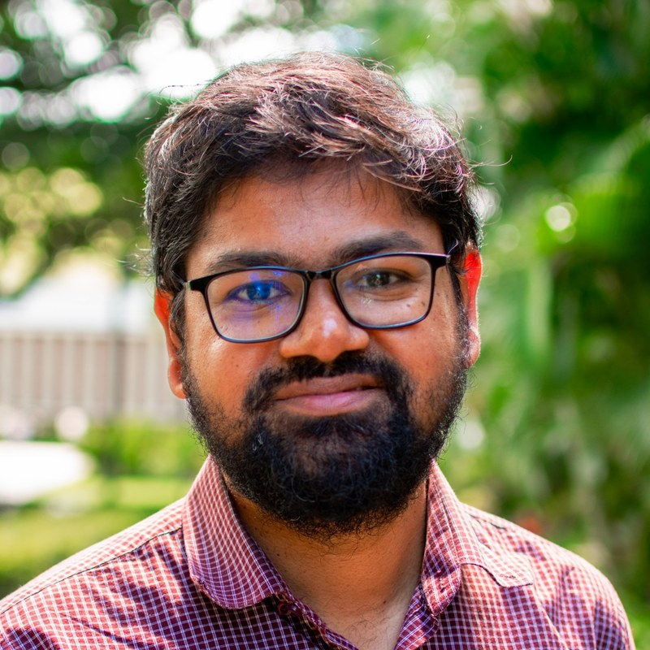

```{=html}
<script type="application/ld+json">
{"@context":"https://schema.org","@type":"Person","name":"Zulfiqure Ali",
 "jobTitle":"Joint Director","worksFor":{"@type":"Organization","name":"Bangladesh Bank"},
 "alumniOf":[{"@type":"CollegeOrUniversity","name":"University of Hawaiʻi at Mānoa"},{"@type":"CollegeOrUniversity","name":"University of Chittagong"}],
 "url":"https://zulfiqure.github.io","image":"https://zulfiqure.github.io/images/profile.jpg",
 "sameAs":["https://orcid.org/0009-0005-3107-5165","https://scholar.google.com/citations?user=jbrH2Y4AAAAJ","https://www.linkedin.com/in/zulfiqure-ali/","https://github.com/zulfiqure"]}
</script>

<section class="hero">
  
  <div class="who">
    <div class="kicker">Central banking · Economics · Finance</div>
    <h1>Zulfiqure Ali</h1>
    <p class="tagline" style="font-style:italic;margin:0.2rem 0 0.8rem;">I study how monetary policy and bank regulation transmit through banking systems in emerging economies.</p>
    <p class="role"><strong>Joint Director, Bangladesh Bank</strong><br>
    MA in Economics, University of Hawaiʻi at Mānoa · East-West Center Fellow<br>
    Chattogram, Bangladesh</p>
    <div class="links">
      <a href="https://scholar.google.com/citations?user=jbrH2Y4AAAAJ"><i class="bi bi-mortarboard"></i> Google Scholar</a>
      <a href="https://orcid.org/0009-0005-3107-5165"><i class="bi bi-person-vcard"></i> ORCID</a>
      <a href="https://www.linkedin.com/in/zulfiqure-ali/"><i class="bi bi-linkedin"></i> LinkedIn</a>
      <a href="https://github.com/zulfiqure"><i class="bi bi-github"></i> GitHub</a>
      <a href="mailto:zulfiqure@gmail.com"><i class="bi bi-envelope"></i> Email</a>
    </div>
  </div>
</section>
```

## About {#about}

I am a Joint Director at **Bangladesh Bank**, the central bank of Bangladesh. Since 2019 I have worked across monetary and foreign exchange policy, on-site bank supervision, risk-based supervision, Basel III implementation and treasury operations. Before joining the central bank, I spent three years in commercial banking as a credit analyst, relationship manager and branch operations manager.

I hold an **MA in Economics from the University of Hawaiʻi at Mānoa**, where I was an East-West Center Graduate Degree Fellow and a graduate teaching assistant. My research brings together policy experience and empirical methods to ask how policy and technology shape banks and labour markets in emerging economies.

::: {.chips}
[Labor Economics]{} [Development Economics]{} [Public Policy]{} [Banking]{} [Finance]{}
:::

## Research interests {#research}

My research asks how policy and technology shape banks and labour markets in emerging economies.

- **Monetary transmission in bank-dominated economies:** how policy rates reach lending and deposit rates when interest rates are controlled or administered.
- **Global shocks and bank behaviour:** how emerging-market banks respond to global monetary tightening, exchange-rate pressure and capital-flow reversals.
- **Technology, finance and work:** how digital finance and AI change banking, financial inclusion and the demand for skills.

## Publications {#publications}

::: {.pub}
[Revisiting the impact of mobile banking in financial inclusion among the developing countries]{.ptitle}

[Akter, U., Anwar, S. M. R., Mustafa, R., & **Ali, Z.** (2021). *International Journal of Financial Research*, 12(2), 62–74.]{.meta}

[DOI: 10.5430/ijfr.v12n2p62](https://doi.org/10.5430/ijfr.v12n2p62) · [Google Scholar](https://scholar.google.com/citations?user=jbrH2Y4AAAAJ)
:::

## Completed research {#completed-research}

::: {.pub}
[The Paradox of Progress: Decomposing the Evolution of the Black–White Wage Gap, 1989–2010]{.ptitle}

[MA capstone, Department of Economics, University of Hawaiʻi at Mānoa, 2026]{.meta}

Using harmonized NLSY79 and NLSY97 data on men aged 26–30 and an Oaxaca–Blinder decomposition, I show that the racial log-wage gap widened from 0.199 to 0.238 between 1989 and 2010. Black men's relative gains in education were more than offset by growth in the unexplained component.
:::

## Experience {#experience}

::: {.entry}
[2019 – present]{.when}

::: {.what}
[Bangladesh Bank]{.title} · [Central bank of Bangladesh]{.org}

Joint Director (2026 – present) · Deputy Director (2022 – 2026) · Assistant Director (2019 – 2022)

Seven years inside a central bank have given me the institutional knowledge and data experience that motivate my research. I contributed to the Monetary Policy Statement and to policy-rate and bank-rate decisions, helped formulate foreign exchange regulation for banks and their offshore units, traded in open-market operations, and worked on risk-based supervision, Basel III implementation and information-system audit. I now lead on-site inspections of commercial bank branches. This work has given me first-hand knowledge of how policy reaches banks and borrowers in an emerging economy, and of the data central banks use to monitor it.

Since completing my MA in May 2026, I have combined this role with independent research and quantitative training.
:::
:::

::: {.entry}
[2025]{.when}

::: {.what}
[Other experience]{.title} · [Hawaiʻi]{.org}

- Planning intern, Hawaiʻi Department of Transportation: pedestrian and bicycle infrastructure, traffic safety and climate policy analysis.
- Fellow, Food Vault Hawaiʻi: data collection and analysis on student food insecurity.
:::
:::

::: {.entry}
[2016 – 2019]{.when}

::: {.what}
[Private commercial bank]{.title} · [Senior Officer, Dhaka]{.org}

Credit analyst, relationship manager and branch operations manager.
:::
:::

## Education {#education}

::: {.entry}
[2024 – 2026]{.when}

::: {.what}
[MA in Economics]{.title} · [University of Hawaiʻi at Mānoa]{.org}

East-West Center Graduate Degree Fellow. Capstone in labor economics.
:::
:::

::: {.entry}
[2016]{.when}

::: {.what}
[MBA in Finance]{.title} · [University of Chittagong]{.org}
:::
:::

::: {.entry}
[2014]{.when}

::: {.what}
[BBA in Finance and Banking]{.title} · [University of Chittagong]{.org}
:::
:::

## Teaching {#teaching}

::: {.entry}
[2025 – 2026]{.when}

::: {.what}
[Graduate Teaching Assistant]{.title} · [Department of Economics, University of Hawaiʻi at Mānoa]{.org}

- ECON 330 Intermediate Macroeconomics (Spring 2026, two sections)
- ECON 130 Principles of Microeconomics (Fall 2025)
:::
:::

**Teaching interests:** principles of economics, intermediate macroeconomics, money and banking, financial institutions and markets, financial inclusion, and the economy of Bangladesh.

## Honours & skills

::: {.grid2}
::: {.card-z}
[Awards & certifications]{.label}

- TK Jayaraman and Family Prize, Best Graduating MA Student, University of Hawaiʻi at Mānoa, 2026
- Burnham Campbell Fellowship Award, Department of Economics, University of Hawaiʻi at Mānoa, 2025 and 2026
- Achievement Scholarship, Department of Economics, University of Hawaiʻi at Mānoa, 2026
- Graduate Research Stipend (merit-based), Department of Economics, University of Hawaiʻi at Mānoa, 2025
- East-West Center Graduate Degree Fellowship, 2024–2026
- Certified Digital Finance Practitioner (CDFP), The Fletcher School, Tufts University, 2024
:::

::: {.card-z}
[Methods & tools]{.label}

- Applied and panel-data econometrics
- Decomposition methods (Oaxaca–Blinder)
- R, Stata, Python
:::
:::

## Contact {#contact}

I welcome conversations about research collaboration, central banking and economics.

::: {.grid2}
::: {.card-z}
[Email]{.label}

- Personal: [zulfiqure@gmail.com](mailto:zulfiqure@gmail.com)
- Bangladesh Bank: [zulfiqure.ali@bb.org.bd](mailto:zulfiqure.ali@bb.org.bd)
- University of Hawaiʻi: [alizulfi@hawaii.edu](mailto:alizulfi@hawaii.edu)
:::

::: {.card-z}
[Location]{.label}

<i class="bi bi-geo-alt"></i> Chattogram, Bangladesh
:::
:::
